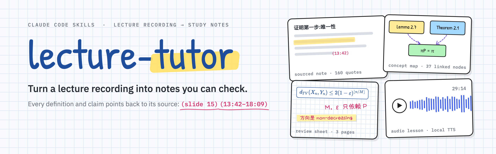
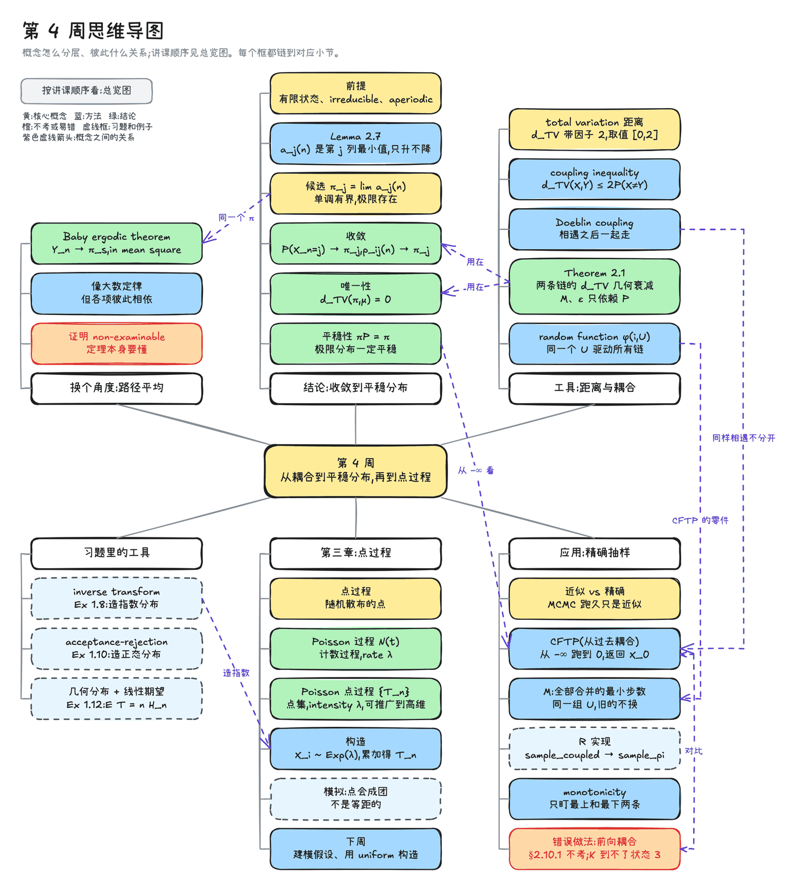
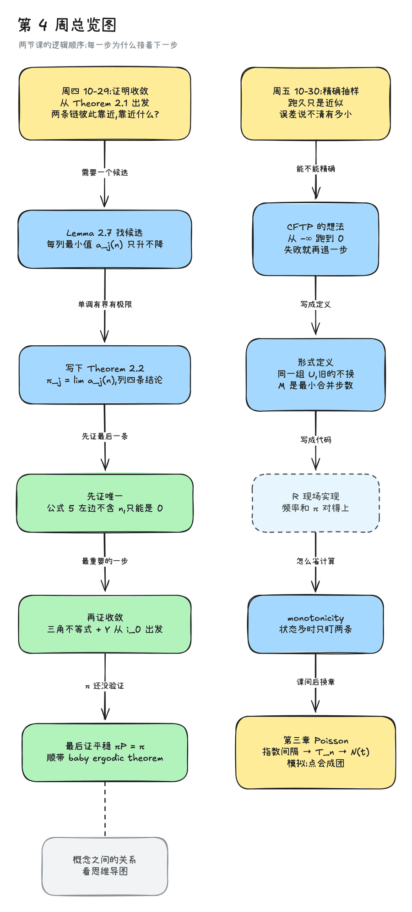
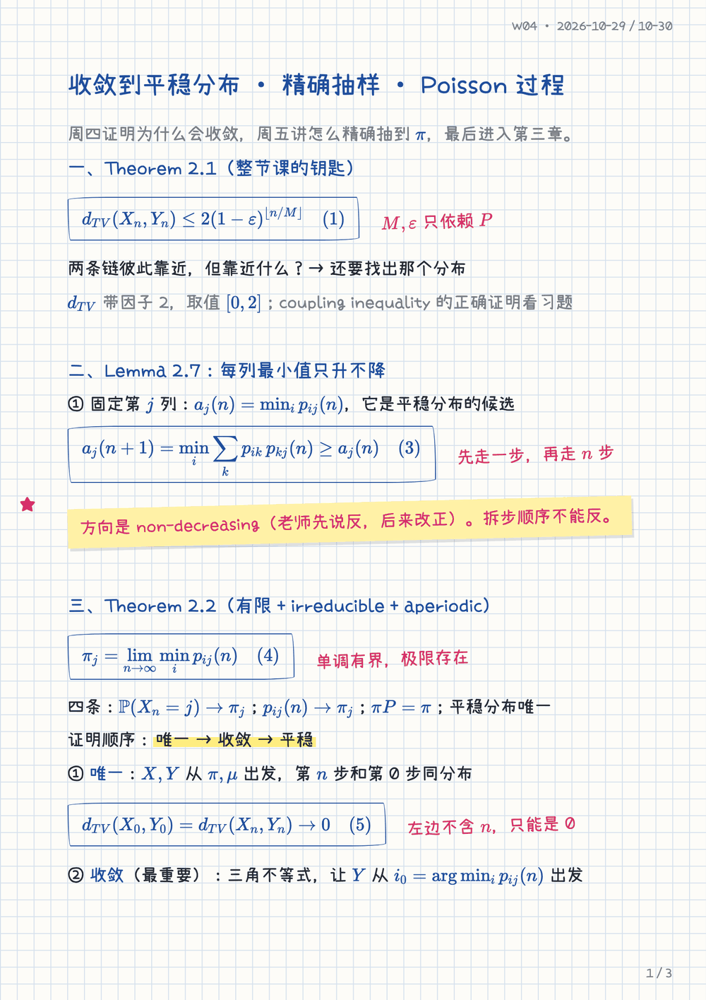
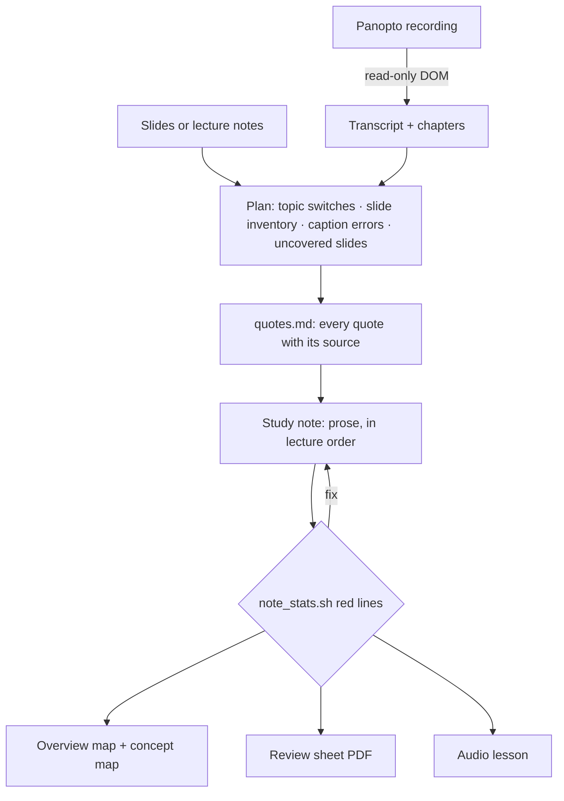

<p align="center">
  <picture>
    <source media="(prefers-color-scheme: dark)" srcset="assets/banner-dark.png">
    
  </picture>
</p>

# Tutor Any Lecture

<p align="center">
  <a href="#install"></a>
  
  
  
  <a href="LICENSE"></a>
</p>

<p align="center">
  <b>English</b> · <a href="README.zh-CN.md">简体中文</a>
</p>

**lecture-tutor** is a set of three [Claude Code](https://claude.com/claude-code) skills that turn one lecture recording into a study pack you can check line by line. Claude reads the Panopto transcript and the slides, then writes a study note that follows the lecture in order. Every definition is quoted from the slides or lecture notes with its location, every spoken explanation carries a `(mm:ss)` timestamp you can jump to, and anything Claude added sits in its own box. From that note it draws hand-drawn Excalidraw maps, typesets a handwritten-style review sheet on grid paper, and records an audio lesson with a local text-to-speech model.

A generic "summarise this lecture" prompt reads well and drifts: you can't tell what the lecturer said from what the model filled in, and the auto-captions' mistakes ("Dublin cobbler" for *Doeblin coupling*) slip straight through. lecture-tutor treats the lecture as the source of truth and makes every claim traceable.

<p align="center">
  <a href="#what-one-lecture-becomes">What you get</a> ·
  <a href="#showcase">Showcase</a> ·
  <a href="#how-it-works">How it works</a> ·
  <a href="#install">Install</a> ·
  <a href="#design-principles">Design principles</a> ·
  <a href="#safety">Safety</a> ·
  <a href="#faq">FAQ</a>
</p>

## What one lecture becomes

| Output | File | What it is |
|---|---|---|
| **Study note** | `W04-讲解-<title>.md` | An explanation written as prose, in the order the lecture went. Definitions quoted verbatim with `(slide N)`, explanations tagged `(mm:ss)`, caption errors fixed against the slides and listed in an errata table, 6–10 self-test questions with folded answers, and a formula sheet. |
| **Exercise note** | `W04-习题.md` | The same treatment for the lecturer's problem-solving videos. |
| **Overview map** | `W04-总览图.excalidraw.md` | A hand-drawn Excalidraw flowchart of the argument: why each step leads to the next. |
| **Concept map** | `W04-思维导图.excalidraw.md` | The week organised by concept. Every node links to the section that explains it, so the map shows up in Obsidian backlinks. |
| **Review sheet** | `W04-手写版.pdf` | 2–4 A4 pages on grid paper in a handwriting font, formulas in blue ink, highlighter and red-pen notes. Made for annotating in Notability or GoodNotes. |
| **Audio lesson** | `W04-语音.m4a` | A 25–40 minute single-voice lesson written for listening, synthesised locally with Qwen3-TTS and checked by transcribing it back with Whisper. |

The notes are written in Chinese (the skills were built for a Chinese-speaking student at an English-language university); technical terms stay in English.

## Showcase

Week 4 of a second-year stochastic processes module: two lectures on convergence to the stationary distribution, coupling from the past and the Poisson process, plus four short exercise videos. 2 h 17 min of recordings, 1,102 transcript lines.

<table>
  <tr>
    <th colspan="3">Concept map: the week by concept, every node linked back to the note</th>
  </tr>
  <tr>
    <td colspan="3"></td>
  </tr>
  <tr>
    <th width="30%">Overview map: the order of the argument</th>
    <th colspan="2">Review sheet: handwritten-style pages on grid paper</th>
  </tr>
  <tr>
    <td valign="top"></td>
    <td valign="top"></td>
    <td valign="top"></td>
  </tr>
</table>

| From this week's recordings | |
|---|---|
| Study note | 7,061 Chinese characters · 20 sections · **160 verbatim quotes · 404 timestamps** · 11 numbered formulas |
| Caption errors fixed | 25, each with the time, the caption text and the correction |
| Self-test | 10 questions aimed at the lecture's most common mistakes |
| Maps | 12-step overview · 37-node concept map, every node linked back to the note |
| Audio lesson | 29 minutes · [43-second sample](assets/showcase/audio-sample.m4a) |

**[See the full example →](examples/stochastic-week4/)** with an excerpt of the note, the errata table, self-test questions and the map sources. Lecturer quotes are redacted on this public page.

## How it works



1. **Find the course.** Course code → Moodle id and local folder, from your config.
2. **Find the recording.** Claude lists every LTI activity and the Panopto block on the Moodle course page, because each course names its recordings differently, then opens the viewer with `autoplay=false`.
3. **Read the transcript.** `panopto_extract.js` reads the transcript, chapters, AI summary and lecture date from the page's DOM. It clicks nothing.
4. **Read everything** and plan: where the lecturer switches topic, a slide-by-slide inventory, a list of misheard words checked against the slides, and the slides that were never covered.
5. **Write.** Quotes go into `quotes.md` with their sources first; the note is then written around them, following the [writing contract](skills/tutor-any-lecture/references/writing.md).
6. **Check.** `note_stats.sh` measures the note against the contract (quote density, paragraph length, heading structure, highlight count) and flags red lines. Every definition on every slide is traced to a place in the note.
7. **Deliver** to the course folder and the Obsidian vault, one `lecture_wN/` folder per week, images in `截图/`.
8. **Draw and typeset** the overview map, concept map and review sheet with the two companion skills.
9. **Record** the audio lesson: a script written for the ear, local TTS, then Whisper back-transcription to check terms and formulas.

## Install

**Requirements:** an agent that loads skills and runs shell commands (Claude Code, Codex and others); either [uv](https://docs.astral.sh/uv/) or Python 3.10+; git, for an install that does not start from a checkout; Node.js only for `npx skills add`. Works on macOS, Linux and Windows x64.

**Option A: `npx skills` (recommended)**

```bash
npx skills add hypersupersheep/tutor-any-lecture
```

This copies the skill into your agent's skills folder. Success check: your agent lists `tutor-any-lecture` among its skills. The command-line tool is installed on first use: the skill's Step 0 runs `tutor-any-lecture doctor --json`, and when the command is missing it offers to run the installer that ships inside the skill with `--cli-only`, since the skill is already in place (`scripts/install.sh`, or `scripts/install.ps1` on Windows).

**Option B: Claude Code plugin**

```text
/plugin marketplace add hypersupersheep/tutor-any-lecture
/plugin install tutor-any-lecture@tutor-any-lecture
```

Success check: `/plugin` shows `tutor-any-lecture` as installed. The command-line tool is installed on first use, as in Option A.

**Option C: ask your agent to install it**

Paste this into your agent:

```text
Install tutor-any-lecture for me. After each step, check the result. If a check fails, stop and tell me what you saw.

1. Clone https://github.com/hypersupersheep/tutor-any-lecture into a folder of your choice.
   Check: the folder contains install.sh and install.ps1.
2. In that folder, run `bash install.sh --yes` on macOS or Linux, or `powershell -NoProfile -ExecutionPolicy Bypass -File install.ps1 -Yes` on Windows (also from Git Bash; `bash install.sh` is not for Windows). Do not pipe any download into a shell. It can take several minutes.
   Check: the exit code is 0 and the last output is a JSON object with "ready": true. On exit code 3, show me what it printed (the "fix" lines of that JSON, or the instructions for installing uv or git) and stop.
3. Read the full path of the command from the file ${XDG_CONFIG_HOME:-$HOME/.config}/tutor-any-lecture/cli-path (on Windows: %APPDATA%\tutor-any-lecture\cli-path) and run `<that path> selftest`.
   Check: the exit code is 0.
4. Look for tutor-any-lecture/SKILL.md in your own skills folder (for example ~/.claude/skills/ or ~/.codex/skills/).
   Check: the file exists. If it does not, run the installer again with `--agents` followed by claude, codex or agents (on Windows: `-Agents`).
```

The installer uses `uv tool install` when uv is present. Otherwise it creates a private environment in `~/.tutor-any-lecture/venv` (`%LOCALAPPDATA%\tutor-any-lecture\venv` on Windows). It installs nothing into your system Python and never downloads a script to run it. It then records the command's full path in the `cli-path` file, copies the skill to the agents it finds (`~/.claude`, `~/.codex`, `~/.agents`), and runs `tutor-any-lecture doctor --json`. Exit codes: 0 ready, 1 failed or cancelled, 2 bad option, 3 needs action (it prints what to do). Add `--dry-run` (`-DryRun`) to see the plan without changing anything, and `--cli-only` (`-CliOnly`) to install the command without copying the skill.

Speech recognition is an add-on, needed only for audio or video that has no captions. It is a large download (several hundred megabytes, more on Apple Silicon), so the installer leaves it out unless you add `--with-asr` (`-WithAsr`); you can run the installer again with it later. Captions, transcripts and slides work without it.

**Option D: Claude.ai (ZIP upload)**

Zip the folder `skills/tutor-any-lecture` and upload it as a skill in Claude.ai. Limits: Claude.ai cannot process large local videos, so this route works from slides, captions and transcripts only.

### Quick start

```bash
tutor-any-lecture selftest
```

This runs a bundled sample (a three-minute mini-lecture with three slides) through the whole pipeline. It needs no network and no speech-to-text model; exit code 0 means the install works. If your shell cannot find the command, use the full path stored in the `cli-path` file. Then give your agent a lecture: `Teach me this lecture: <file, folder or link>`.

## Usage

Log in to Moodle once in Claude's browser, then ask in Claude Code:

| You say | Claude does |
|---|---|
| `讲一下 COURSE101 第 4 周` | Finds the week's recordings, reads transcripts and slides, writes the study note, and waits for your review. |
| `做手写版和总览图` | Typesets the review sheet and draws the overview map from the approved note. |
| `做个语音版` | Writes the audio script, synthesises it locally and spot-checks it with Whisper. |
| `把这段录像的转写拿下来` | Just locates the recording and extracts the transcript, for use elsewhere. |

English requests work too; the notes come out in Chinese.

## What's inside

| Skill | Use it for | Works on its own |
|---|---|---|
| [`lecture-tutor`](skills/tutor-any-lecture/SKILL.md) | The full pipeline: locate the recording, extract the transcript, write and check the note, deliver, audio lesson | Needs the two below for maps and review sheets |
| [`handwritten-notes-pdf`](skills/handwritten-notes-pdf/SKILL.md) | A light markup → handwritten-style A4 PDF on grid paper, with KaTeX formulas, highlighter, red pen and sticky notes | Yes, for any notes |
| [`excalidraw-concept-map`](skills/excalidraw-concept-map/SKILL.md) | A Mermaid flowchart → hand-drawn Excalidraw drawing that Obsidian can open and edit, plus a PNG | Yes, for any topic |

```text
skills/tutor-any-lecture/
├── SKILL.md                     the workflow, for any agent
├── references/
│   ├── writing.md               the writing contract for the note
│   ├── teaching.md              pretest, quiz, reviews and card rules
│   ├── gate.md                  what `verify` checks
│   ├── profile.md               settings
│   ├── adapters/                one file per source: local, url, import, panopto, moodle
│   ├── agents/                  agent-specific notes: claude-code, codex, generic
│   ├── output-targets/          markdown, obsidian
│   └── audio-script-rules.md    how to write and synthesise the audio lesson
└── scripts/
    ├── install.sh               installer for macOS and Linux
    ├── install.ps1              installer for Windows
    ├── panopto_extract.js       read-only DOM extraction in the Panopto viewer
    └── tts_synthesize.py        audio script → m4a with local Qwen3-TTS
```

## Design principles

1. **The lecture is the source of truth.** Quotes are pulled into `quotes.md` with their sources before the note is written, and every sentence attributed to the lecturer must trace back to it. Notation follows the slides, even when it clashes; clashes are flagged, not "fixed".
2. **Prose, not outlines.** Headings appear only where the lecturer actually changes topic, since headings help recall only at real topic shifts (Hyönä & Lorch, 2004). Reasoning lives in sentences, not bullet fragments. The contract was revised after two controlled runs on the same lecture, with and without the rules.
3. **What was said, kept apart from what was added.** Supplements, doubts and computed numbers each get a labelled box; the body text is only what the lecture contains.
4. **Practice that matches the exam.** Self-test questions target the lecture's most common misconceptions and match exam question types (Dunlosky et al., 2013); self-explanation prompts ask *why*, not *what* (Bisra et al., 2018).
5. **Audio written for the ear.** One voice, short sentences, formulas read by meaning and anchored to numbered equations in the note, because complex reasoning is harder to follow by ear than on the page (Leahy & Sweller, 2011).
6. **Measured, not eyeballed.** A script checks quote density, paragraph length, structure and highlights before anything is delivered.

## Safety

- **Read-only** on Moodle and Panopto: it never submits work, answers quizzes, posts, books slots, or presses Edit, Cuts, Streams, Download or Share.
- **No credentials.** It never types passwords or MFA codes and never reads access tokens or cookies. At a login page or a "Verify you are human" check it stops and hands over to you.
- **Asks before downloading** any recording, every time. It never circumvents DRM and never uses your passwords or cookies. Downloading audio is your choice and responsibility, through the `public_video_audio` switch.
- **For personal study** of recordings you are entitled to watch. Don't redistribute recordings, transcripts or notes made from copyrighted lectures. The showcase in this repo contains generated diagrams and short excerpts only, with lecturer quotes redacted.

**Video audio (off by default).** The setting is `public_video_audio`. Turning it on lets tutor-any-lecture download the audio track of a video (YouTube, Bilibili and other sites yt-dlp supports) when no usable captions exist, transcribe it locally, then delete it. Until you turn it on, no audio is downloaded. From then on the decision and the responsibility are yours for every address you give, a school's or a meeting platform's recordings included: check that you are allowed to download it, and follow the site's terms and copyright. The tool does not check them for you. Use it for personal study only. The tool never uses your login or cookies, so a recording behind a sign-in is not reachable this way: there use the platform's captions, or a file you downloaded yourself. DRM is never circumvented.

## FAQ

<details>
<summary><b>Does it work without Panopto?</b></summary>

The extraction script targets Panopto's viewer. With another platform, give Claude a transcript file, or let it transcribe a recording you are allowed to download with mlx-whisper; from step 4 on, the pipeline is the same. `panopto.md` also notes where Echo360 keeps its transcripts.

</details>

<details>
<summary><b>Can it write English notes?</b></summary>

Not out of the box. The writing contract and the audio rules are written in Chinese and tuned for Chinese prose (character counts, punctuation, TTS reading rules). Translating `references/writing-rules.md` and adjusting the thresholds in `note_stats.sh` is the place to start.

</details>

<details>
<summary><b>Do I need a Mac?</b></summary>

Only for the audio lesson and local transcription, which run on MLX. Notes, maps and review sheets need Chrome and Python, nothing platform-specific; set `CHROME_PATH` if Chrome isn't in its default location.

</details>

<details>
<summary><b>Why is the concept map not generated automatically like the overview map?</b></summary>

Mermaid's automatic layout routes cross-branch relation lines straight through other nodes once a map has 30+ nodes. The showcase concept map was laid out by a small per-week script on top of the same Excalidraw renderer. Generalising that layout is the most obvious next step.

</details>

## Acknowledgements

[Excalidraw](https://github.com/excalidraw/excalidraw) and [mermaid-to-excalidraw](https://github.com/excalidraw/mermaid-to-excalidraw) · the [Obsidian Excalidraw plugin](https://github.com/zsviczian/obsidian-excalidraw-plugin) · [KaTeX](https://katex.org) · [Qwen3-TTS](https://huggingface.co/mlx-community/Qwen3-TTS-12Hz-1.7B-CustomVoice-8bit) via [mlx-audio](https://github.com/Blaizzy/mlx-audio) · [Whisper](https://github.com/openai/whisper) via [mlx-whisper](https://github.com/ml-explore/mlx-examples) · Patrick Hand and Xiaolai SC fonts · the [Agent Skills](https://github.com/anthropics/skills) format.

## License

[MIT](LICENSE). Fonts and libraries loaded at render time keep their own licenses.
