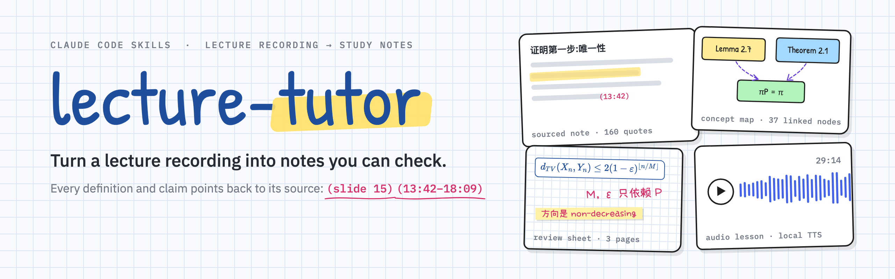
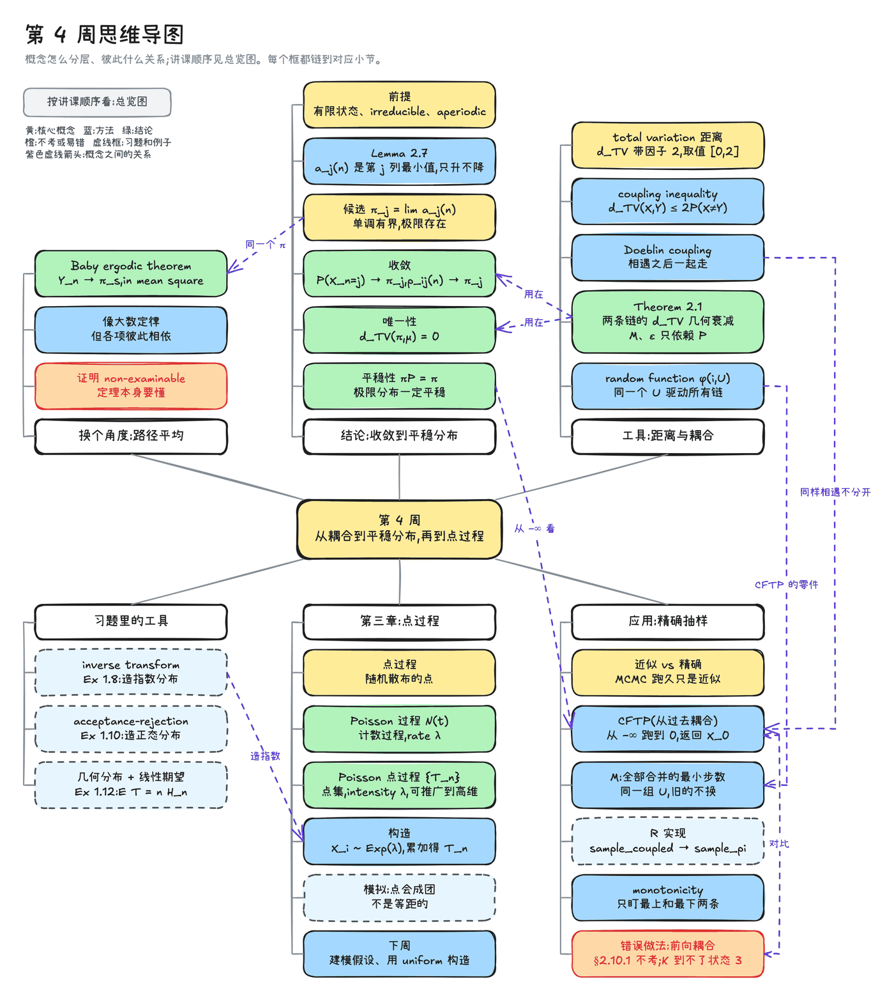
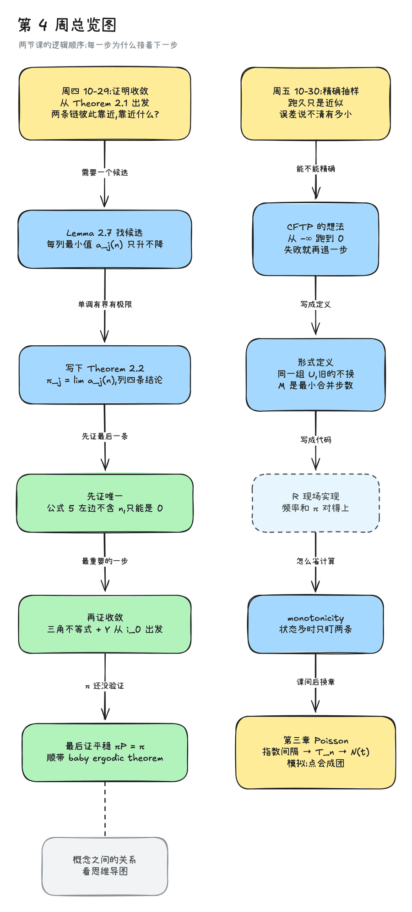
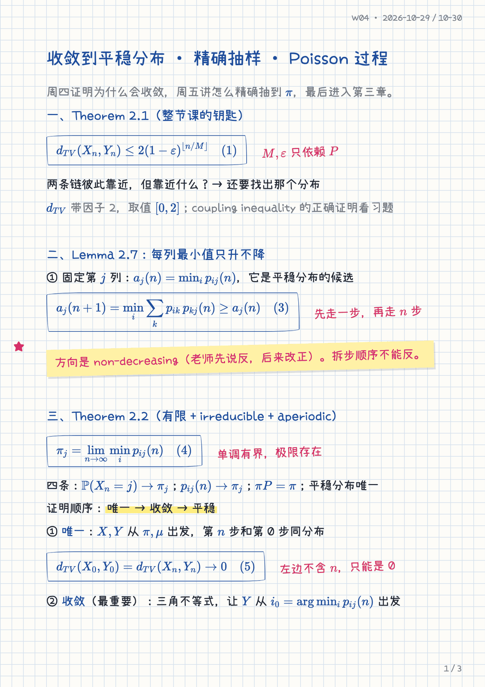
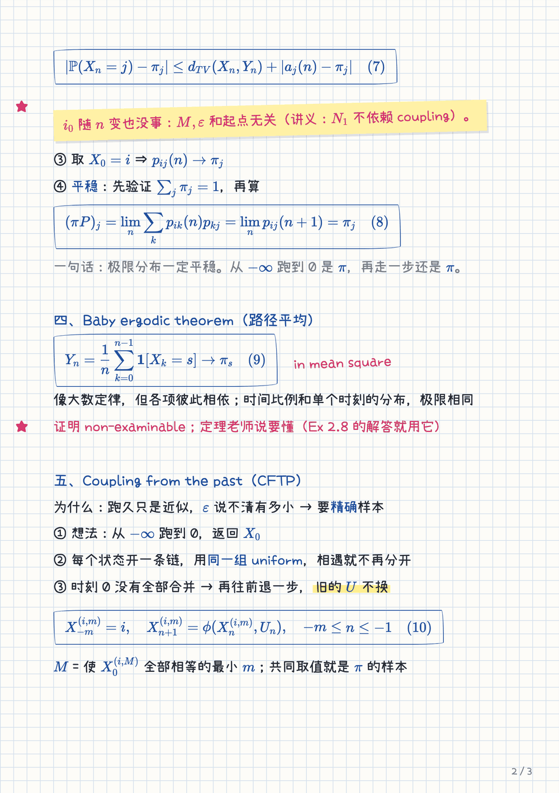
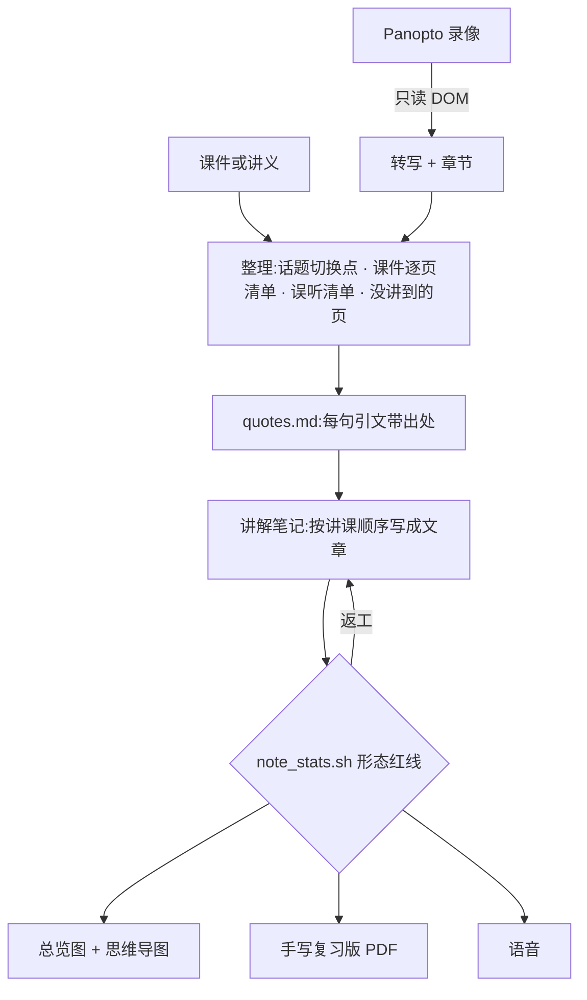

<p align="center">
  <picture>
    <source media="(prefers-color-scheme: dark)" srcset="assets/banner-dark.png">
    
  </picture>
</p>

# Tutor Any Lecture

<p align="center">
  <a href="#安装"></a>
  
  
  
  <a href="LICENSE"></a>
</p>

<p align="center">
  <a href="README.md">English</a> · <b>简体中文</b>
</p>

**lecture-tutor** 是三个 [Claude Code](https://claude.com/claude-code) skill,把一节课的录像变成一套能逐句核对的复习材料。Claude 读 Panopto 的转写和课件,按讲课顺序写一份讲解笔记:定义从课件或讲义逐字引用并注明位置,老师口头的解释都带 `(mm:ss)` 时间戳,点开录像就能跳过去;Claude 自己补充的内容单独放在框里。再从这份笔记出发,画手绘风的 Excalidraw 总览图和思维导图,排一份网格纸手写复习版 PDF,用本地语音模型录一节语音课。

直接让大模型"总结这节课",读起来顺,但会走样:分不清哪些是老师讲的、哪些是模型补的,自动字幕的错误("Dublin cobbler" 其实是 *Doeblin coupling*)也会原样混进去。lecture-tutor 以课堂为唯一来源,每一句都能找到出处。

<p align="center">
  <a href="#一节课产出什么">产出</a> ·
  <a href="#案例">案例</a> ·
  <a href="#工作流程">工作流程</a> ·
  <a href="#安装">安装</a> ·
  <a href="#设计原则">设计原则</a> ·
  <a href="#安全边界">安全边界</a> ·
  <a href="#常见问题">常见问题</a>
</p>

## 一节课产出什么

| 产出 | 文件 | 内容 |
|---|---|---|
| **讲解笔记** | `W04-讲解-<英文主题>.md` | 按讲课顺序写成文章,不是提纲。定义逐字引用并标 `(slide N)`,口头解释标 `(mm:ss)`,字幕误听对照课件更正并列表,附 6–10 道自测题(答案折叠)和公式速查表。 |
| **习题** | `W04-习题.md` | 老师讲题视频的讲解,出处规则相同。 |
| **总览图** | `W04-总览图.excalidraw.md` | 手绘风流程图,讲清每一步为什么接着下一步。 |
| **思维导图** | `W04-思维导图.excalidraw.md` | 按概念分层。每个节点都链到讲解里对应的小节,Obsidian 的反向链接面板里能看到。 |
| **手写复习版** | `W04-手写版.pdf` | 2–4 页 A4 网格纸,手写字体,公式用蓝墨水色的 KaTeX 排版,配荧光笔和红笔批注,适合导入 Notability、GoodNotes 继续写。 |
| **语音** | `W04-语音.m4a` | 25–40 分钟的单人讲解,专为"听"重写,用本地 Qwen3-TTS 合成,再用 Whisper 转回文字抽查术语和公式读法。 |

笔记用中文写,专业术语保留英文。

## 案例

一门大二随机过程课的第 4 周:两节课(收敛到平稳分布、coupling from the past、Poisson 过程),外加四段习题视频。录像共 2 小时 17 分钟,转写 1,102 句。

<table>
  <tr>
    <th colspan="3">思维导图:按概念组织这一周,每个节点都链回笔记</th>
  </tr>
  <tr>
    <td colspan="3"></td>
  </tr>
  <tr>
    <th width="30%">总览图:论证的顺序</th>
    <th colspan="2">手写复习版:网格纸上的手写风页面</th>
  </tr>
  <tr>
    <td valign="top"></td>
    <td valign="top"></td>
    <td valign="top"></td>
  </tr>
</table>

| 这一周的产出 | |
|---|---|
| 讲解笔记 | 7,061 个汉字 · 20 节 · **160 处原话引用 · 404 个时间戳** · 11 个编号公式 |
| 字幕更正 | 25 处,每处写明时间、转写原文和更正 |
| 自测 | 10 题,针对这节课最常见的错法 |
| 两张图 | 12 步的总览图 · 37 个节点的思维导图,每个节点都链回笔记 |
| 语音 | 29 分钟 · [43 秒样例](assets/showcase/audio-sample.m4a) |

**[看完整案例 →](examples/stochastic-week4/)**:讲解节选、字幕纠错表、自测题和两张图的源文件。公开页面里老师的原话已隐去。

## 工作流程



1. **定位课程**:课程代码 → 配置里的 Moodle id 和本地文件夹。
2. **找录像**:每门课给录像起的名字都不一样,所以 Claude 列出 Moodle 课程页上全部 LTI 活动和 Panopto 区块再挑,打开 viewer 时带 `autoplay=false`。
3. **取转写**:`panopto_extract.js` 从页面 DOM 读转写、章节、AI 摘要和讲课日期,不点任何按钮。
4. **读材料,先整理**:老师在哪里换话题、课件逐页清单、对照课件的误听清单、课上没讲到的页。
5. **写**:先把要引用的原话连同出处抽到 `quotes.md`,再围绕引文写正文,遵守[写作契约](skills/tutor-any-lecture/references/writing-rules.md)。
6. **自检**:[`note_stats.sh`](skills/tutor-any-lecture/scripts/note_stats.sh) 按契约量化检查(引文密度、段落长度、标题结构、高亮数量),亮红线就返工;再按课件逐页核对每个定义落在笔记哪里。
7. **交付**:存进课程文件夹和 Obsidian vault,每周一个 `lecture_wN/`,图放 `截图/`。
8. **画图、排版**:用另外两个 skill 画总览图、思维导图,排手写复习版。
9. **录语音**:写一份适合听的讲稿,本地合成,再用 Whisper 转回文字核对术语和公式。

## 安装

**需要**:带浏览器工具的 Claude Code(桌面版的内置浏览器,或 Claude in Chrome)、Python 3.10+、Google Chrome、ffmpeg。语音需要 Apple Silicon 的 Mac。Obsidian 和 Excalidraw 插件可选。

**方式一:复制 skill**

```bash
npx skills add hypersupersheep/tutor-any-lecture
```

**方式二:作为 Claude Code 插件安装**

```text
/plugin marketplace add hypersupersheep/tutor-any-lecture
/plugin install tutor-any-lecture@tutor-any-lecture
```

再把 `requirements.txt` 里的包装进你想让脚本用的 Python 环境。

**配置**文件夹和课程:

```bash
mkdir -p ~/.config/lecture-tutor
cp lecture-tutor/skills/tutor-any-lecture/config.example.yaml ~/.config/lecture-tutor/config.yaml
```

填上课程资料文件夹、Obsidian 笔记文件夹、Python 解释器、学校的 Moodle 和 Panopto 地址,每门课一条。字段说明见 [`config.example.yaml`](skills/tutor-any-lecture/config.example.yaml)。

## 用法

先在 Claude 的浏览器里登录一次 Moodle,然后在 Claude Code 里说:

| 你说 | Claude 做什么 |
|---|---|
| `讲一下 COURSE101 第 4 周` | 找到这一周的录像,读转写和课件,写讲解笔记,等你验收 |
| `做手写版和总览图` | 从验收过的笔记排手写复习版、画总览图 |
| `做个语音版` | 写语音稿,本地合成,用 Whisper 抽查 |
| `把这段录像的转写拿下来` | 只定位录像、取出转写,给别的用途 |

## 仓库里有什么

| Skill | 用途 | 能不能单独用 |
|---|---|---|
| [`lecture-tutor`](skills/tutor-any-lecture/SKILL.md) | 完整流程:找录像、取转写、写笔记并自检、交付、语音 | 画图和手写版要靠下面两个 |
| [`handwritten-notes-pdf`](skills/handwritten-notes-pdf/SKILL.md) | 简化标记 → 网格纸手写风 A4 PDF,带 KaTeX 公式、荧光笔、红笔和便利贴 | 能,任何笔记都行 |
| [`excalidraw-concept-map`](skills/excalidraw-concept-map/SKILL.md) | Mermaid 流程图 → Obsidian 里能打开、能编辑的手绘风 Excalidraw 图,附 PNG | 能,任何话题都行 |

```text
skills/tutor-any-lecture/
├── SKILL.md                     流程
├── config.example.yaml
├── references/
│   ├── writing-rules.md         讲解笔记的写作契约
│   ├── audio-script-rules.md    语音稿怎么写、怎么合成
│   ├── panopto.md               在 Moodle 上找录像、取转写
│   └── cowork.md                在 Claude Cowork 里运行的差别
└── scripts/
    ├── panopto_extract.js       在 Panopto viewer 里只读地取 DOM
    ├── panopto_to_files.py      拆成转写、章节、元数据三个文件
    ├── note_stats.sh            按写作契约量化检查笔记
    └── tts_synthesize.py        语音稿 → m4a,本地 Qwen3-TTS
```

## 设计原则

1. **课堂是唯一来源**。动笔前先把原话连同出处抽进 `quotes.md`,正文里归于老师的每句话都要能在里面找到。记号跟课件走,课件自相矛盾时标出来,不擅自"修正"。
2. **写文章,不写提纲**。只在老师真正换话题的地方加标题:标题只在话题切换处帮助回忆(Hyönä & Lorch, 2004)。推理写成句子,不拆成碎片化的列表。写作契约在同一节课上做过两轮对照实验(给规则 / 不给规则)后修订。
3. **讲过的和补充的分开**。补充、存疑、自己算的数各有带标签的框,正文只写课上有的。
4. **练习贴近考试**。自测题针对这节课最常见的误解,题型贴近考试(Dunlosky et al., 2013);自我解释问"为什么",不问"是什么"(Bisra et al., 2018)。
5. **语音为耳朵而写**。单人讲解、短句、公式按意思读并对应笔记里的编号,因为长段推理听起来比看起来难得多(Leahy & Sweller, 2011)。
6. **用数字检查,不凭感觉**。交付前脚本检查引文密度、段落长度、结构和高亮。

## 安全边界

- **对 Moodle 和 Panopto 只读**:不交作业、不答 quiz、不发帖、不预约,不点 Edit、Cuts、Streams、Download、Share。
- **不碰凭据**:不输密码或 MFA,不读 access token 和 cookie;遇到登录页或"Verify you are human"就停下交给你。
- **下载录像前每次都问**,老师关了下载就不绕过。
- **只用于个人学习**你有权观看的录像。不要传播录像、转写,或根据受版权保护的课程做的笔记。本仓库的案例只有生成的图和简短节选,老师原话已隐去。

## 常见问题

<details>
<summary><b>没有 Panopto 能用吗?</b></summary>

取转写的脚本针对 Panopto 的 viewer。用别的平台时,直接给 Claude 一份转写文件,或者让它用 mlx-whisper 转写你有权下载的录像;从第 4 步起流程完全一样。`panopto.md` 里也写了 Echo360 的转写在哪。

</details>

<details>
<summary><b>能写英文笔记吗?</b></summary>

暂时不行。写作契约和语音规则都是中文写的,针对中文行文调过(字数口径、标点、TTS 读法)。想要英文笔记,从翻译 `references/writing-rules.md`、调整 `note_stats.sh` 的阈值开始。

</details>

<details>
<summary><b>一定要 Mac 吗?</b></summary>

只有语音和本地转写要 Mac,它们跑在 MLX 上。笔记、图和手写版只需要 Chrome 和 Python;Chrome 不在默认位置时设环境变量 `CHROME_PATH`。

</details>

<details>
<summary><b>为什么思维导图不像总览图那样自动生成?</b></summary>

节点超过 30 个时,Mermaid 的自动排版会让跨分支的关系线穿过别的节点。案例里的思维导图是每周用一个小脚本在同一个 Excalidraw 渲染器上手工排的坐标。把这套排版通用化是最自然的下一步。

</details>

## 致谢

[Excalidraw](https://github.com/excalidraw/excalidraw) 和 [mermaid-to-excalidraw](https://github.com/excalidraw/mermaid-to-excalidraw) · [Obsidian Excalidraw 插件](https://github.com/zsviczian/obsidian-excalidraw-plugin) · [KaTeX](https://katex.org) · [Qwen3-TTS](https://huggingface.co/mlx-community/Qwen3-TTS-12Hz-1.7B-CustomVoice-8bit)(经 [mlx-audio](https://github.com/Blaizzy/mlx-audio))· [Whisper](https://github.com/openai/whisper)(经 [mlx-whisper](https://github.com/ml-explore/mlx-examples))· Patrick Hand 和小赖字体 · [Agent Skills](https://github.com/anthropics/skills) 格式。

## 许可

[MIT](LICENSE)。渲染时加载的字体和库遵循各自的许可。
