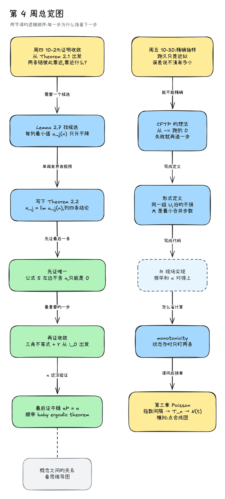
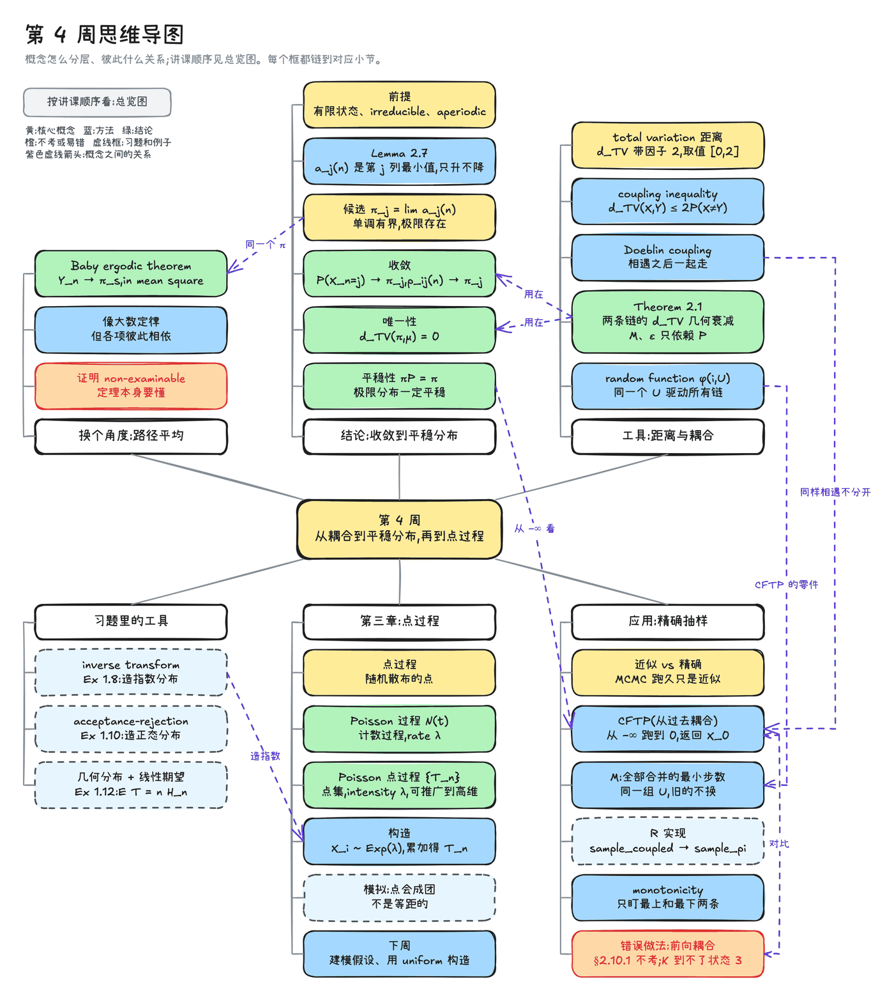
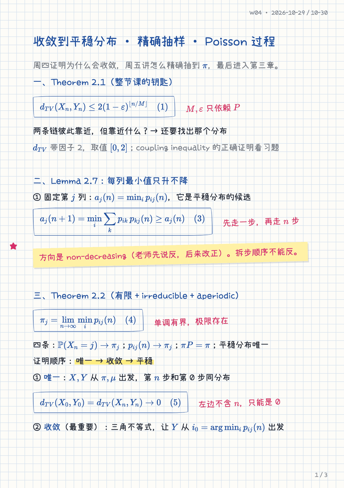
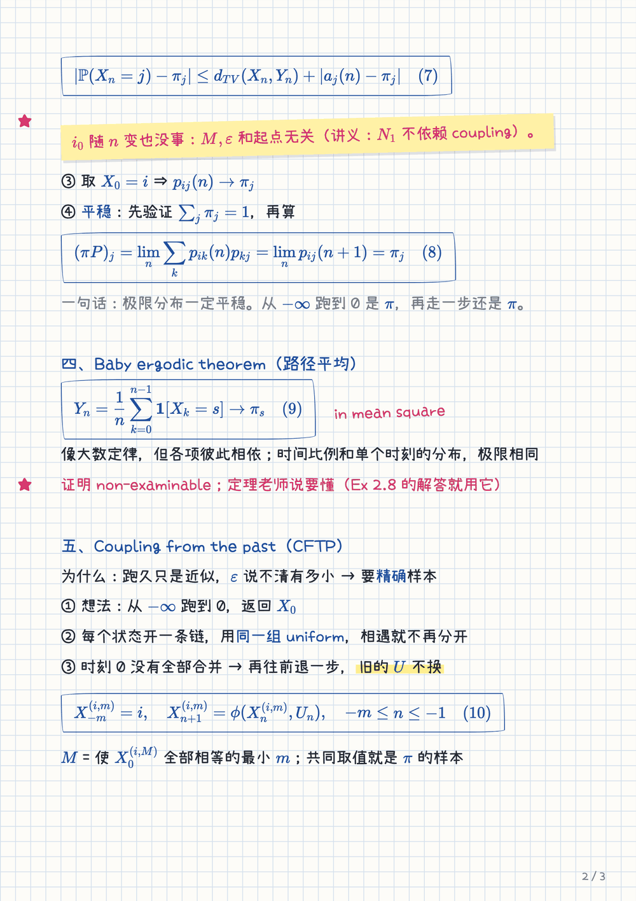
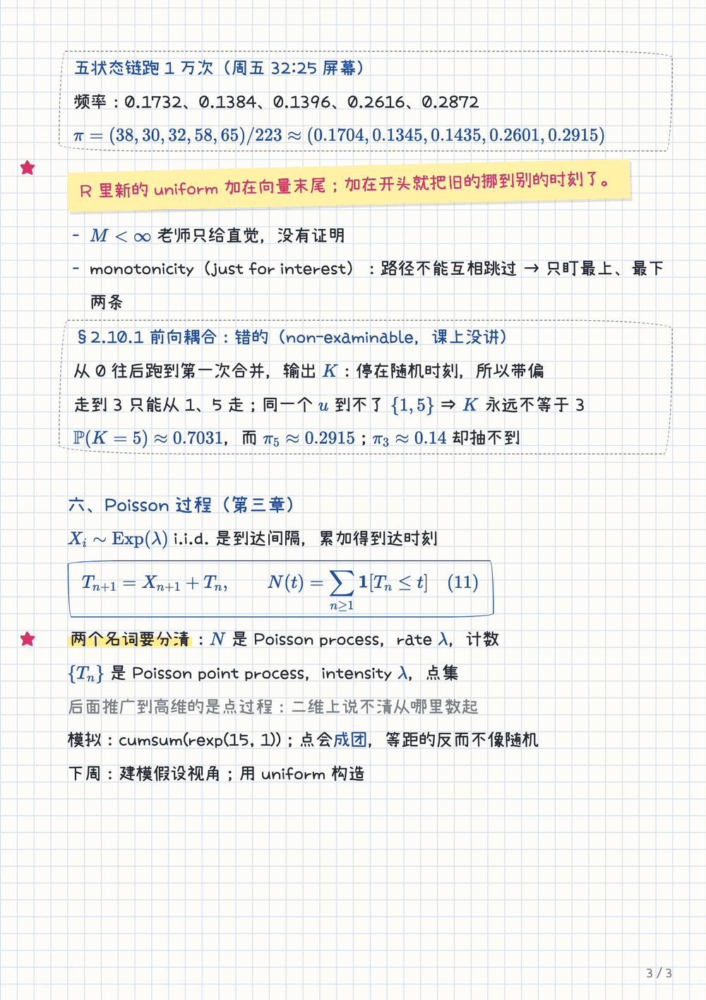
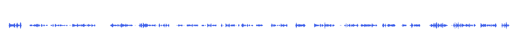

# Example: one week of a stochastic processes module

Week 4 of a second-year stochastic processes module, taught as two lectures plus four short exercise videos. Everything on this page is real output from `lecture-tutor`, with three edits for publishing: the course code is removed from titles, verbatim lecturer quotes in the excerpts are replaced by `"[quote]"`, and only excerpts of the notes are shown. Recording links, the lecturer's name and photos of the lecturer's handwriting are not published.

[Inputs and outputs](#inputs-and-outputs) · [Overview map](#overview-map) · [Concept map](#concept-map) · [Review sheet](#review-sheet) · [Study note](#study-note-excerpt) · [Audio](#audio-lesson) · [File layout](#file-layout)

## Inputs and outputs

| Input | |
|---|---|
| Lecture 1 | Convergence to the stationary distribution · 43 min · 307 transcript lines |
| Lecture 2 | Coupling from the past, then the Poisson process · 49 min · 404 lines |
| Exercise videos | Coupling inequality, inverse transform, acceptance–rejection, coupon collector · 4 videos, 44 min · 391 lines |
| Course material | Lecture notes (HTML) and the lecturer's handwritten pages |

| Output | |
|---|---|
| Study note | 7,061 Chinese characters · 20 sections · 160 verbatim quotes · 404 timestamps · 11 numbered formulas · 25 transcription fixes · 10 self-test questions |
| Exercise note | 2,325 characters · 50 quotes · 143 timestamps |
| Overview map | 12 steps in lecture order, each linked to its section, plus a pointer to the concept map |
| Concept map | 37 nodes, each linked to the section that explains it |
| Review sheet | 3 A4 pages on grid paper |
| Audio lesson | 29 minutes in 11 segments |

## Overview map

The order of the argument: why each step leads to the next. Thursday on the left, Friday on the right.

<p align="center"></p>

Source: [`overview.mmd`](overview.mmd). Render it yourself:

```bash
python3 skills/excalidraw-concept-map/scripts/render_excalidraw.py examples/stochastic-week4/overview.mmd \
  --md overview.excalidraw.md --png overview.png --title "第 4 周总览图"
```

## Concept map

The same week organised by concept instead of by time: tools at the top right, conclusions in the middle, applications and exercises below. Purple dashed arrows mark relations across branches. Every node links to the note section that explains it; the links are written into the file's `## Element Links`, so they show up in Obsidian's backlinks panel.

<p align="center"></p>

## Review sheet

A short handwritten-style summary for annotating on an iPad, not a copy of the note. Formulas are typeset with KaTeX in blue ink, so nothing is miscopied.

<table>
  <tr>
    <td></td>
    <td></td>
    <td></td>
  </tr>
</table>

Source: [`review-sheet.md`](review-sheet.md), in the markup described in [`handwritten-notes-pdf`](../../skills/handwritten-notes-pdf/SKILL.md).

## Study note excerpt

One section of the note, unchanged except for the redacted quotes and math syntax adapted for GitHub. In the real note each `"[quote]"` is the lecturer's exact words, and the italic line under the heading says which part of which recording, lecture notes and handwritten page the section covers.

---

### 证明第一步:唯一性

*录像 周四 13:42–18:09 · 讲义 §2.8 · 周四手写 p2*

老师从定理的最后一条开始。设 $`\pi,\mu`$ 都平稳,即 $`\pi P=\pi`$、$`\mu P=\mu`$;取转移矩阵都是 $`P`$、初始分布分别是 $`\pi,\mu`$ 的两条链 $`X,Y`$。反复乘 $`P`$ 得到 $`\pi P^n=\pi`$、$`\mu P^n=\mu`$,意思是 "[quote]"(周四 15:37–15:42)。所以 $`X_n`$ 和 $`X_0`$ 同分布,$`Y_n`$ 和 $`Y_0`$ 同分布。

为什么要费这个功夫?因为 Theorem 2.1 只管 $`n`$ 很大的时候,而我们想比较的是两个初始分布 $`\pi`$ 和 $`\mu`$。平稳性正好把两者连起来:第 $`n`$ 步的分布和第 0 步一样,而 $`d_{TV}`$ 只看分布(周四 16:15–16:28),于是

```math
d_{TV}(X_0,Y_0)=d_{TV}(X_n,Y_n)\ \to\ 0 \qquad (5)
```

后半是 Theorem 2.1。关键在左边不含 $`n`$:它 "[quote]"(周四 17:02–17:18),"[quote]"(周四 17:18–17:24)。$`d_{TV}(\pi,\mu)=0`$ 就是 $`\pi=\mu`$。这一步最容易写漏的是"左边是常数"这句话,没有它,(5) 只是一个极限,推不出相等。irreducible 的假设也藏在这里,因为它是 Theorem 2.1 的前提。

---

### Transcription fixes

Auto-captions mangle names and symbols. The note corrects them against the lecture notes and lists every fix; five of the 25 rows:

| 时间 | 转写原文 | 应为 |
|---|---|---|
| 周四 2:37;周五 0:33、7:45 | "Dublins approach"、"doubling coupling"、"Dublin cobbler" | Doeblin |
| 周四 15:01、17:24 | "distributed like pie"、"like moo" | $`\pi`$、$`\mu`$ |
| 周四 17:36 | "the station Arabs" | stationary distributions |
| 周四 37:38 | "the apparent Frobenius theorem" | Perron–Frobenius theorem |
| 周四 42:12 | "So it's non-negotiable" | non-examinable |

### Self-test

Two of the ten questions. Answers are folded so you write yours first.

**6.** 实现 CFTP 时,如果每次增大 $`m`$ 都把全部 uniform 重新抽一遍,会出什么问题?

<details>
<summary>答案</summary>

不同的 $`m`$ 对应的不再是同一条从过去跑来的路径,"再往前加也不改变时刻 0 的值"这个性质就没了。输出会偏向容易快速合并的结果,不再是精确的 $`\pi`$。

</details>

**9.** $`\lambda=2`$ 的 Poisson 过程。求 $`\mathbb E[T_5]`$ 和 $`\mathbb P(N(1)=0)`$,并写一行 R 抽 50 个到达时刻。

<details>
<summary>答案</summary>

$`\mathbb E[T_5]=5/\lambda=2.5`$。$`\mathbb P(N(1)=0)=\mathbb P(X_1>1)=e^{-2}\approx0.1353`$。`cumsum(rexp(50, 2))`,注意 `rexp` 的第二个参数是 rate;Python 是 `np.cumsum(rng.exponential(1/2, 50))`,第一个参数是 scale,等于 $`1/\lambda`$。

</details>

## Audio lesson

A single-voice lesson written for listening: short sentences, formulas read by meaning and referred to by their number in the note. Synthesized locally with Qwen3-TTS, then transcribed back with Whisper to check terms and formulas.



[Download a 43-second sample](../../assets/showcase/audio-sample.m4a) (m4a, 0.5 MB): the uniqueness argument from the excerpt above, in the audio's own words.

## File layout

What this week looks like in the Obsidian vault:

```text
<course>/week4/
├── lecture_w4/
│   ├── W04-讲解-Convergence-Exact-Sampling-Poisson.md   study note
│   ├── W04-习题.md                                       exercise videos
│   ├── W04-语音.m4a                                      audio lesson
│   ├── W04-手写版.pdf                                    review sheet
│   ├── W04-总览图.excalidraw.md                          overview map
│   └── W04-思维导图.excalidraw.md                        concept map
└── 截图/                                                 17 images embedded in the notes
```

Transcripts, chapter lists, the audio script and the map sources stay in the course folder under `笔记/源文件/`, next to the finished files in `笔记/lecture_w4/`.
